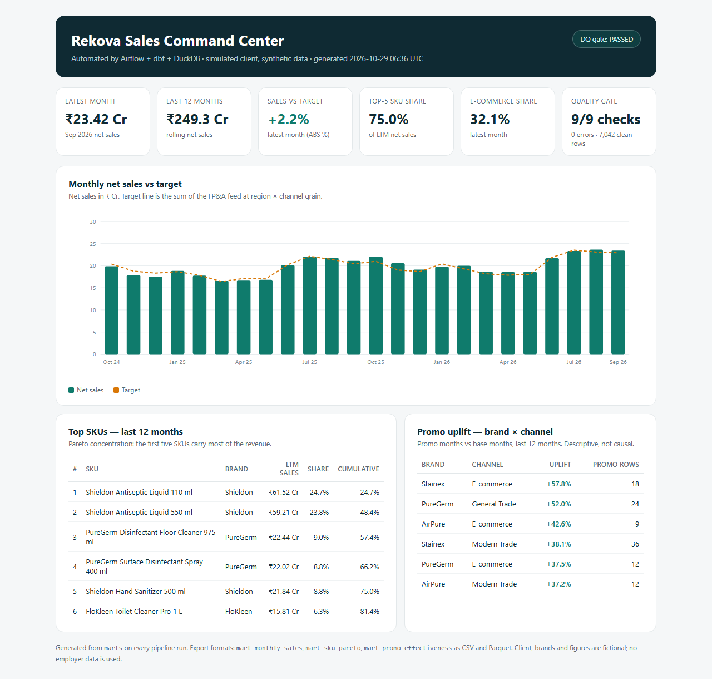

# Rekova Data Platform — Airflow + dbt + DuckDB

### A scheduled, tested, CI-backed analytics pipeline for a simulated CPG client

[](https://github.com/vibhapotabatti/rekova-data-platform/actions/workflows/ci.yml)
[](https://github.com/vibhapotabatti/rekova-data-platform)

> **Honest framing:** *Rekova Consumer Care* is a fictional client and every row is synthetic
> data from a seeded generator. This is a portfolio project that simulates the engineering
> side of the FMCG analytics work I support at Infosys — it is **not** real client delivery
> and contains no employer data. See [docs/interview_notes.md](docs/interview_notes.md).

This is the third project in the Rekova portfolio ladder — it takes the SQL/Power BI
analysis ([Project 1](https://github.com/vibhapotabatti/rekova-sales-analytics)) and the
Python forecasting work ([Project 2](https://github.com/vibhapotabatti/rekova-demand-forecasting))
and turns them into a **repeatable production pipeline**: ingest → dbt staging → quality
gates → dbt marts → tests → published dashboard, orchestrated by Airflow and gated by CI.

## What "production-grade" means here

- **Layered warehouse** — raw landing schema → staging views (cleaned, typed, deduped) →
  dimensional marts. Every layer is SQL you can inspect and test.
- **Quality gates before trust** — Python checks quantify the six deliberate feed defects
  (duplicates, missing net sales, returns, orphan SKUs, whitespace regions, a missing
  monthly extract) and fail the run on unexpected key/amount errors.
- **Tests at the right grain** — dbt generic tests (unique, not-null, relationships,
  accepted values) plus singular tests for the business rules that actually matter:
  one row per SKU × distributor × month, net sales never above gross, target grain is
  region × channel × month, no orphan keys, returns excluded from the sales fact.
- **Cross-project reconciliation as a test** — the pipeline asserts that latest-month
  revenue, top-5 SKU share and e-commerce share still match the numbers independently
  produced by the SQL and Python projects. If a transformation drifts, CI fails.
- **Orchestration** — an Airflow DAG with retries, task-level gating and monthly schedule;
  the same steps run locally through a thin runner (Airflow is Linux/Docker-native).
- **CI** — GitHub Actions installs the stack, regenerates data from scratch, runs the full
  pipeline and pytest, then uploads the published outputs as artifacts.

## Latest run (auto-generated)

| Metric | Value |
|---|---|
| Clean sell-out rows | **7,042** (from 7,094 raw, defects handled) |
| Latest month net sales | **₹23.42 Cr** (Sep 2026) |
| Last 12 months net sales | **₹249.32 Cr** |
| Top-5 SKU share (LTM) | **75.0%** |
| E-commerce share (latest month) | **32.1%** |
| dbt models / tests | **18 models · 54 tests**, all green |

The published dashboard is generated on every run: [`outputs/dashboard.html`](outputs/dashboard.html)
(open it in a browser) with CSV and Parquet exports of every mart for BI tools.



## Architecture

```mermaid
flowchart LR
    A[Seeded CSV generator<br/>6 injected feed defects] --> B[(Raw landing<br/>DuckDB schema: raw)]
    B --> C[Airflow: ingest<br/>+ load audit]
    C --> D[Python quality gate<br/>key/amount errors fail the run]
    D --> E[dbt staging<br/>dedupe · type · derive net sales]
    E --> F[dbt tests<br/>grain · relationships]
    F --> G[dbt marts<br/>star schema + KPI marts]
    G --> H[dbt tests<br/>business rules + reconciliation]
    H --> I[Export<br/>CSV · Parquet · dashboard.html]
    I --> J[Power BI / downstream BI]
```



**Stack:** Python 3.11 · DuckDB (warehouse) · dbt-core + dbt-duckdb · Apache Airflow 2.9
(reference Docker deployment) · pytest · GitHub Actions.

## Quickstart (local, no Airflow needed)

```powershell
pip install -r requirements.txt

# regenerate the synthetic source data (seeded, deterministic)
python scripts\generate_data.py

# ingest -> quality gate -> dbt staging -> dbt marts -> tests -> export
python scripts\run_pipeline.py
```

Then open `outputs/dashboard.html`.

Every step is idempotent: raw tables are replaced on ingest, dbt models are rebuilt,
and the warehouse file is the only state that matters. Delete `warehouse/rekova.duckdb`
and rerun to prove it.

## Airflow

The DAG lives at [`dags/rekova_pipeline.py`](dags/rekova_pipeline.py). It runs monthly:

```
ensure_source_data → ingest_raw → quality_gate → dbt_build_staging
→ dbt_build_marts → dbt_test_all → export_dashboard
```

Because Airflow does not run natively on Windows, local development uses the same
steps through `scripts/run_pipeline.py`. A reference Docker Compose stack is provided in
[`docker-compose.airflow.yml`](docker-compose.airflow.yml) (official Airflow image +
Postgres + mounted repo); see [docs/airflow.md](docs/airflow.md) for the two commands.
The DAG is plain Airflow 2.9 code — no custom plugins.

## Repository layout

```
rekova-data-platform/
├── dags/rekova_pipeline.py        # Airflow DAG (monthly, retries, gated tasks)
├── src/rekova_platform/
│   ├── config.py                  # paths + env overrides
│   ├── ingest.py                  # CSV -> DuckDB raw schema + load audit
│   ├── quality.py                 # pre-transform quality gate + dq_report.json
│   └── export.py                  # marts -> CSV/Parquet + dashboard.html
├── scripts/
│   ├── generate_data.py           # seeded synthetic data generator
│   └── run_pipeline.py            # local orchestrator (same steps as the DAG)
├── dbt_project/
│   ├── models/staging/            # cleaned, typed, deduped views
│   ├── models/marts/              # dims, facts, KPI marts
│   └── tests/                     # singular business-rule tests
├── tests/                         # pytest: generator, ingest, quality, marts
├── .github/workflows/ci.yml       # full pipeline + tests on every push
├── docker-compose.airflow.yml     # reference Airflow deployment
└── docs/                          # architecture + interview notes
```

## Design decisions (the interview answers)

1. **Why dbt instead of one big Python script?** The transformation logic is SQL, versioned
   and testable at each layer. Tests are declared next to models, so a change to staging
   cannot silently break a mart.
2. **Why DuckDB?** It is a real analytical warehouse (columnar, vectorized) that fits in a
   single file — the pipeline runs on a laptop and in CI with zero infrastructure. Swapping
   to Snowflake/BigQuery is a profile + adapter change, not a rewrite.
3. **Why keep the defects?** Real feeds are dirty. The pipeline demonstrates detection,
   quantification and remediation instead of pretending clean data exists.
4. **Why fail on some defects but only warn on others?** Null keys and impossible amounts
   are hard errors. Duplicates/returns/whitespace are known, quantified and handled in
   staging — warning keeps them visible without blocking every run.
5. **Why assert the old projects' numbers?** Reconciliation is the cheapest regression test
   in analytics. If the warehouse says ₹23.42 Cr and the SQL project says ₹23.42 Cr, the
   pipeline did not change the business meaning.
6. **What would change at real scale?** Incremental dbt models on month partitions, source
   freshness SLAs, Airflow on MWAA/Cloud Composer, secrets in a vault, and dbt artifacts
   (docs + run results) published per run.

## What I would build next

- Incremental materializations + late-arriving data handling
- Source freshness checks against an upstream landing bucket
- Elementary/dbt-expectations for anomaly detection on row counts and revenue
- Power BI Service refresh against the exported Parquet marts

---

**Companion projects:** [SQL + Power BI sales analytics](https://github.com/vibhapotabatti/rekova-sales-analytics) ·
[Python demand forecasting](https://github.com/vibhapotabatti/rekova-demand-forecasting)
